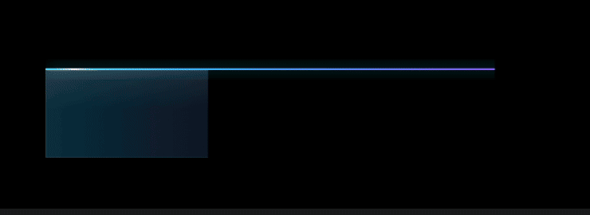

# OGraf Flame OFX

Use [OGraf](https://www.ebu.ch/ograf) HTML graphics as **native nodes in Autodesk Flame**.

An OFX plugin with Chromium built in: every OGraf template becomes a Flame effect, and the
template's fields (name, title, colours…) become ordinary Flame controls. Change a value and the
frame re-renders. No intermediate render, no image sequence, no import dialog.



- **One node per template.** Every `.ograf.zip` in your template folders appears under
  **OGraf** in Flame's OFX browser, named after the template.
- **Template fields become controls.** Text becomes a text field, colours become colour
  pickers (keyframeable), numbers become sliders, true/false becomes a checkbox.
- **Timing that follows the clip.** The In plays at the start of the segment, the graphic holds,
  and the Out finishes on the last frame. Trim the segment and the super retimes.
  **In Duration** and **Out Duration** stretch or squeeze the template's own animation.
- **Frame-accurate.** Each frame is rendered through the template's non-real-time API
  (`goToTime`), so scrubbing and backwards playback give identical pixels.
- **OGraf Template node.** One more effect with a file picker: choose any `.ograf.zip`
  and its controls rename themselves to that template's fields. New templates work without
  restarting Flame.

Templates come from [OGraf Studio](https://github.com/zerodensity/ograf-studio), the open-source
editor for EBU OGraf graphics. Export them with the **Non-real-time** or **Dual** profile.

## Requirements

- macOS 13 or later on Apple Silicon
- Autodesk Flame (tested with Flame 2026.2.2)
- To build: Xcode command-line tools and CMake 3.21+

## Build and install

```sh
./build.sh       # fetches CEF, OpenFX and nlohmann/json into third_party/ on first run (~135 MB)
./install.sh     # copies the bundle to /Library/OFX/Plugins (asks for your password)
```

Quit Flame before installing. `./install.sh --uninstall` removes the plugin.

The bundle is ad-hoc signed, which is enough on the Mac that built it. To install on other
machines, sign it with your Developer ID or build it there.

## Templates

The plugin looks for `*.ograf.zip` files, up to three folders deep, in:

1. the folders listed in `$OGRAF_TEMPLATES` (colon separated), and
2. `templateDirs` in `~/Library/Application Support/OGraf Flame/config.json`:

   ```json
   { "templateDirs": ["~/Templates/OGraf", "/Volumes/Projects/graphics"] }
   ```

3. Otherwise: `~/ograf-studio/out` and `~/Documents/OGraf Studio/Projects`.

Real-time-only packages are skipped. Flame asks plugins for their effect list once, at startup,
so a **new** template needs a Flame restart before it appears as its own node. Use the
**OGraf Template** node in the meantime. Re-exporting an existing template does not need a restart.

## Controls

| Control | Meaning |
|---|---|
| *Template fields* | One control per field in the template's schema, using its label and default. |
| In Duration | Length of the In animation, in frames. Defaults to the template's own timing. |
| Out Duration | Length of the Out animation, in frames. It always ends on the clip's last frame. |
| Play Out | Off: the graphic holds to the end of the clip instead of animating out. |
| Start Offset | Frames to wait after the clip starts before the In begins. |
| Over Source | On: graphic composited over the source clip. Off: graphic only, premultiplied alpha. |
| Template | *(OGraf Template node only)* the `.ograf.zip` to render. |

```
clip:      |-- In Duration --|---------- hold ----------|-- Out Duration --|
template:  |  In, scaled     |  on-air pose, real time   |  Out, scaled     |
```

## How it works

```
Flame ──OFX render (any thread)──▶ OGrafFlame.ofx ──main thread──▶ Chromium (CEF, off-screen)
                                        │                               │
                                        │◀── premultiplied BGRA ────────┘
                                        └─▶ scaled into Flame's image, composited over the source
```

- [CEF](https://bitbucket.org/chromiumembedded/cef) runs **inside Flame's process**. On macOS
  Chromium must run on the main thread, which belongs to Flame, so it starts with an external
  message pump serviced from Flame's run loop instead of taking it over.
- Render threads hand work to the main thread and wait with a timeout, so a stuck page reports
  an error instead of hanging Flame.
- Each template package is extracted once to `~/Library/Caches/OGrafFlame` and served from an
  in-memory `https://ograf.local/` origin; nothing is fetched from the network.
- The graphic is driven like any OGraf non-real-time renderer: `load({renderType:
  'non-realtime'})`, `setActionsSchedule([update, play, stop])` derived from the clip and the
  timing controls, then `goToTime(ms)` per frame.
- Each Flame session gets its own Chromium profile folder, so several Flame sessions or
  background renders can run at the same time.

## Limitations

- **Colour:** graphics render in sRGB and are written to Flame unconverted. On ACES or linear
  projects, add a colour transform after the node.
- **Text fields cannot be keyframed.** Flame does not animate OFX string parameters. Colours and
  numbers can be keyframed.
- **macOS on Apple Silicon only** for now. Linux and Intel builds are not set up.
- Objects and arrays in a template's schema are not exposed as controls yet.

## Troubleshooting

- `~/Library/Logs/OGrafFlame.log`: template discovery, Chromium start-up, render errors.
- `~/Library/Logs/OGrafFlame-chromium.log`: Chromium's own log.
  Launch Flame with `OGRAF_VERBOSE=1` for page console output and more detail.

## Development

```sh
./build/cmake/ograf_timing_test                       # clip ↔ template timing
./build/cmake/ograf_mockhost build/OGrafFlame.ofx.bundle <template.ograf.zip> <outDir>
./build/cmake/ograf_harness  build/OGrafFlame.ofx.bundle <template.ograf.zip> <outDir>
```

`ograf_mockhost` is a minimal OFX host that drives the plugin the way Flame does: describe,
create instance, parameter changes and renders from a background thread. It writes PNGs of the
rendered frames. `ograf_harness` exercises only the Chromium renderer.

## Licence

[GNU Affero General Public License v3.0](LICENSE). Third-party components and their licences
are listed in [THIRD_PARTY.md](THIRD_PARTY.md).

Autodesk and Flame are trademarks of Autodesk, Inc. This project is not affiliated with
Autodesk or the EBU.
